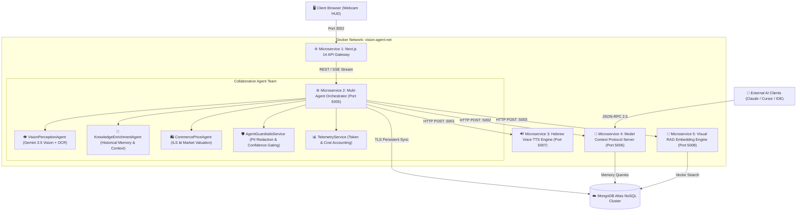

# 🚀 Smart Camera Vision Recognition & AI-Native Multi-Agent System (v2.0)

[](https://github.com/IDAN2468D/Smart-Camera-Vision-Recognition-Multi-Agent/actions)
[-black?style=flat&logo=next.js)](https://nextjs.org/)
[](https://python.org/)
[](https://github.com/agno-agi/agno)
[](https://ai.google.dev/)
[](https://www.mongodb.com/atlas)
[-blueviolet?style=flat)](https://modelcontextprotocol.io/)
[-2496ED?style=flat&logo=docker&logoColor=white)](https://docker.com)
[](LICENSE)

An enterprise-grade, **AI-Native Multi-Agent Vision System** built for real-time visual recognition, human face and hand detection, OCR text extraction, historical RAG enrichment, neural Hebrew speech synthesis (TTS), live commerce valuation in Israeli New Shekels (₪), zero-touch gesture triggers, and Model Context Protocol (MCP) tool serving.

Built with **Next.js 14 (TypeScript & Tailwind CSS)**, **Flask & Agno Multi-Agent Framework**, **Google Gemini 3.5 Flash Lite**, **Edge TTS**, and **MongoDB Atlas**, decoupled into **4 autonomous Microservices in Docker Compose**.

---

## 🎯 System Architecture Overview



---

## ✨ Key Enterprise Capabilities

### 1. ⚡ High-FPS Live Camera Feed (30 / 60 FPS)
* **Hardware-Accelerated Stream**: Video capture configured with explicit `frameRate: { ideal: 60, min: 30 }` constraints and MJPG hardware compression.
* **Live Hardware FPS Counter**: Real-time measurement utilizing the modern `requestVideoFrameCallback` API.
* **Zero-Lag HUD Overlay**: High-speed targeting reticle, resolution switcher (720p HD / 1080p FHD), and mirror toggle.

### 2. 🤖 Multi-Agent Collaborative Perception (Agno + Gemini 3.5 Flash Lite)
* **Triple Fallback Resilience**: Ultra-fast primary model `gemini-3.5-flash-lite`, with seamless automatic failover to `gemini-3.5-flash` and `gemini-3.8-flash`.
* **Structured Multi-Entity Extraction**: Pydantic validated output identifying objects, human faces, hands, gestures, and extracted OCR text.
* **Knowledge & History RAG**: Correlates current visual input with past detections in MongoDB Atlas to produce insightful context in Hebrew.

### 3. 🔊 Hebrew Voice Agent (Neural TTS)
* **Natural Speech Synthesis**: Powered by `edge-tts` using the `he-IL-AvriNeural` voice engine.
* **Interactive Next.js Audio Player**: Auto-plays upon scan completion, animated waveform equalizer, and instant mute toggle.
* **Decoupled Service**: Hosted on its own dedicated microservice container (`vision_ai_voice`).

### 4. 🛍️ Commerce & Market Price Intelligence
* **Autonomous Product Valuation**: Automatically detects commercial gadgets, electronics, accessories, and tools.
* **Israeli Market Pricing**: Estimates current retail price ranges in Israeli New Shekels (`₪`) and synthesizes key specifications in Hebrew.

### 5. 🔌 Native Model Context Protocol (MCP Server v2.0)
* **Standard JSON-RPC 2.0**: Implements the official MCP specification on `POST /api/mcp` and `GET /api/mcp`.
* **Exposed AI Tools**:
  * `get_latest_detection`: Returns the latest visual perception state and Hebrew insights.
  * `search_visual_memory`: Semantic and keyword memory search over historical MongoDB records.
  * `get_system_telemetry`: Operational diagnostics, model IDs, and database health.
* Connects directly to **Claude Desktop**, **Cursor IDE**, and custom autonomous agent workflows.

### 6. 🛡️ AI Guardrails & Human-In-The-Loop (HITL) Evaluation
* **Automatic PII Redaction**: Regex-based redaction of Israeli phone numbers, emails, and credit card numbers from camera OCR text.
* **Confidence Gating**: Flags low-confidence recognitions (<60%) for human review.
* **One-Click Human Feedback**: Users can verify or flag detections in the Next.js HUD (`thumbs_up` / `thumbs_down`), storing evaluation telemetry in MongoDB.

### 7. 💰 Context & Cost Engineering
* **Token Accounting**: Tracks prompt and completion tokens for every visual inference.
* **Real-Time Cost Counter**: Calculates the exact financial cost per scan in USD and ILS (`~₪0.0012` per scan).
* **Live Latency Telemetry**: Displays round-trip agent latency in milliseconds.

### 8. 📊 Comprehensive Reporting & Interactive Docs
* **Swagger / OpenAPI 3.0 UI**: Interactive API documentation embedded at `/api/docs`.
* **One-Click Export**: Export detection logs directly to formatted **Excel (`.xlsx`)** or landscape **PDF (`.pdf`)** reports.

---

## 🐳 Microservices Topology

| Service | Container Name | Internal Port | Host Port | Description | Health Endpoint |
| :--- | :--- | :--- | :--- | :--- | :--- |
| **API Gateway & Frontend** | `vision_ai_frontend` | `3000` | **`3002`** | Next.js 14 App Router, Web HUD, Lightbox Gallery | `GET /api/health` |
| **Backend Orchestrator** | `vision_ai_backend` | `5000` | **`5005`** | Flask REST API, Agno Multi-Agent Team, SSE Bus | `GET /api/health` |
| **MCP Server** | `vision_ai_mcp` | `5002` | **`5006`** | Model Context Protocol JSON-RPC 2.0 Server | `GET /health` |
| **Voice TTS Engine** | `vision_ai_voice` | `5001` | **`5007`** | Neural Hebrew Speech Synthesizer (`edge-tts`) | `GET /health` |
| **Visual RAG Embedding Engine** | `vision_ai_embedding` | `5003` | **`5008`** | Multimodal embeddings (`gemini-embedding-2`) + Atlas Vector Search | `GET /health` |

### 🧠 Embedding Microservice (Visual RAG)

Every scan is embedded as **image + structured vision text** into one 768-dim vector and stored on the detection (`image_embedding`, tagged with `embedding_model`). Before enrichment, the orchestrator searches for visually/semantically similar past detections and passes them to `KnowledgeEnrichmentAgent`.

| Endpoint | Description |
| :--- | :--- |
| `POST /embed` | `{"text": "...", "image_base64": "..."}` → vector |
| `POST /search/similar` | `{"query": "something to drink from", "limit": 5}` or `{"vector": [...], "model": "..."}` |
| `POST /index/ensure` | Creates the Atlas `vectorSearch` index (`image_embedding` cosine + `embedding_model` filter) |
| `POST /backfill` | `{"limit": 50}` — embeds existing detections that have no vector yet |
| Backend: `GET /api/detections/similar?q=...` | Semantic search proxied through the backend |
| MCP tool: `semantic_visual_search` | Same search exposed to external AI clients |

**One-time setup** after `docker compose up -d`:

```bash
curl -X POST http://localhost:5008/index/ensure                                  # create the vector index
curl -X POST http://localhost:5008/backfill -H "Content-Type: application/json" -d '{"limit": 200}'
```

> Resilience: if the service is down the backend embeds in-process; if `$vectorSearch` is unavailable (index building / non-Atlas MongoDB) search falls back to local cosine similarity; without a Gemini key a deterministic local hashing embedding is used (`local-hash-v1`, never mixed with Gemini vectors).

---

## 🚀 Quickstart Guide

### Option 1: Running in Docker (Recommended)

1. **Clone the repository:**
   ```bash
   git clone https://github.com/IDAN2468D/Smart-Camera-Vision-Recognition-Multi-Agent.git
   cd Smart-Camera-Vision-Recognition-Multi-Agent
   ```

2. **Configure environment variables:**
   ```bash
   cp .env.example .env
   # Edit .env and insert your GEMINI_API_KEY and MONGO_URI
   ```

3. **Start the microservices stack:**
   ```bash
   docker compose up -d
   ```

4. **Access the application:**
   * 🖥️ **Web Application HUD**: [http://localhost:3002](http://localhost:3002)
   * 📄 **Interactive Swagger API Docs**: [http://localhost:3002/api/docs](http://localhost:3002/api/docs)
   * 🔌 **Model Context Protocol (MCP)**: [http://localhost:3002/api/mcp](http://localhost:3002/api/mcp)

---

### Option 2: Running Locally on Windows Host

1. **Set up Python Virtual Environment:**
   ```cmd
   python -m venv venv
   venv\Scripts\activate
   pip install -r requirements.txt
   ```

2. **Set up Frontend Dependencies:**
   ```cmd
   cd frontend
   npm install
   cd ..
   ```

3. **Launch the full system:**
   ```cmd
   run_system.bat
   ```

---

## 🧪 Testing & CI/CD Pipeline

The project includes an automated **GitHub Actions CI/CD pipeline** (`.github/workflows/ci.yml`) executing on every push and pull request:

```bash
# Run backend test suite
pytest tests/ -v

# Run frontend build verification
cd frontend && npm run build
```

---

## 🔒 Security & Data Protection

* **Environment Secrets**: Credentials (`GEMINI_API_KEY`, `MONGO_URI`) are strictly loaded via `.env` and excluded from git tracking through a hardened `.gitignore`.
* **Zero Accidental Data Loss**: Database writes utilize non-destructive upserts and parameterized queries.
* **PII Guardrails**: Incoming frames with sensitive telephone numbers or financial identifiers are scrubbed before persistence.

---

## 📄 License

Distributed under the **MIT License**. Developed as an AI-Native Senior Backend Capstone Project following the *Back End AI Hi-Tech Gateway* curriculum by Yaniv Arad.
